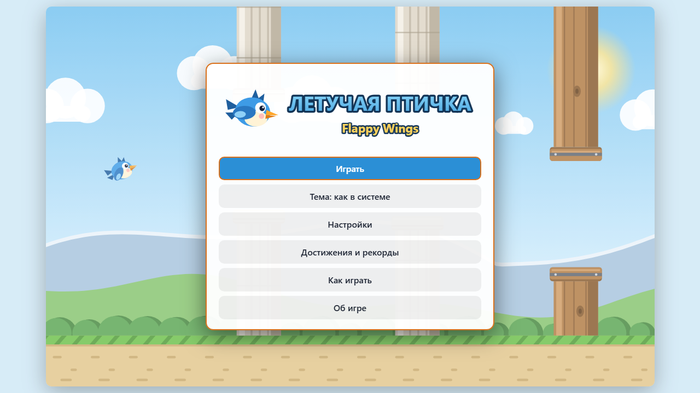
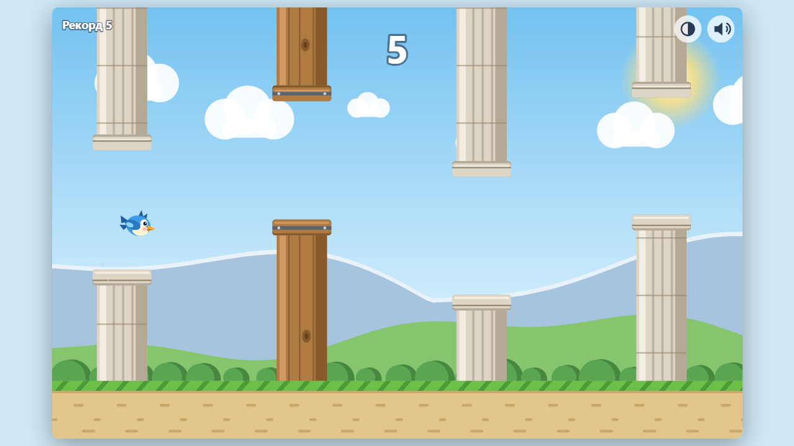

<div align="center">

# Flappy Wings

**Flappy Wings («Летучая птичка») is a fly-between-the-columns game in a single HTML page: the bird flies on its own, you flap its wings. It runs in the browser with no server and no internet: open `index.html` or play it online.**

[**▶ Play online →**](https://alexalesha.github.io/FlappyWings/) &nbsp;·&nbsp; [Русская версия этого файла](README.ru.md)

[](#) [](https://github.com/ALEXalesha/FlappyWings/actions/workflows/ci.yml) [](LICENSE) [](https://developer.mozilla.org/docs/Web/HTML) [](https://alexalesha.github.io/FlappyWings/) [](https://claude.com/claude-code)

Code, tests and docs are written by Claude (Anthropic) in Claude Code. Ideas, testing and decisions - Alexey.

</div>

> Fan-made game. Not affiliated with the authors or rights holders of the well-known games of this genre.

The interface is in Russian.





## What is in the game

- Fly between columns of stone and wood: each column gives one point; the gap gets a little narrower and the flight a little faster with every column.
- Three difficulty levels with their own records; medals for one flight: bronze feather at 10 points, silver at 25, gold at 50, platinum at 100.
- Achievements and records, a light and a dark theme (or as in the system), settings with key rebinding, gamepad support.
- The game pauses by itself when the window or tab is hidden.
- The bird, the columns and the landscape are drawn by code, sounds and music are synthesised with WebAudio; no files from the internet.

## Controls

| Key | Action |
|---|---|
| Space, ↑, W, click or tap | flap |
| P or Esc | pause |
| R | start again |
| M | sound on/off |
| T | light or dark theme |

## Run locally

Open `index.html` in Chrome, Edge or Firefox. Everything is in the repository; nothing is downloaded.

## Tests

The laws are Playwright tests in `tests/`. They open the page by its file address in headless
Chromium, one at a time:

```
npm install
npx playwright install chromium
npm test
node tests/mutate.js     # mutation check: broken copies of the game must fail the laws
```

Mouse capture in the tests is always a stub (a real `requestPointerLock` in headless Chromium on
Windows can clip the user's cursor). The mutation check breaks a copy of the game in a temporary
folder and never touches `index.html`.
The pictures above were made headless.

## History

The game was made in the [Hub](https://github.com/ALEXalesha/ALEXalesha.github.io) collection (folder `web/flappy-wings`), where it also runs in the Hub ([play there](https://alexalesha.github.io/)). This repository carries the game with its commit history.

## Licence

MIT, see [LICENSE](LICENSE).
